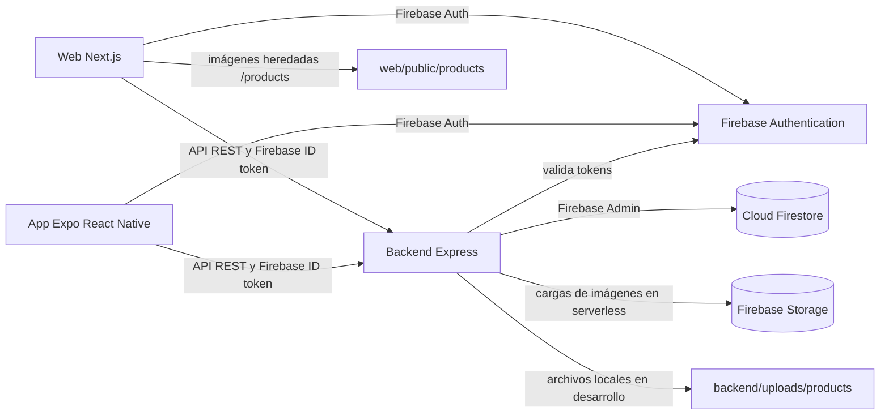

# FerreStock360

FerreStock360 es un sistema académico para administrar una ferretería desde una aplicación web y otra móvil. Centraliza el catálogo, las existencias, las reservas y los pedidos para reducir la gestión manual y mantener una sola fuente de datos. El alcance actual incluye operaciones de tienda, administración y retiro de pedidos; el pago con tarjeta es una simulación y no procesa transacciones reales.

## Tecnologías

| Área | Tecnologías y uso |
| --- | --- |
| Web | Next.js 16, React 19, TypeScript y Tailwind CSS 4 |
| Móvil | Expo SDK 58, React Native 0.88, Expo Router y TypeScript |
| API | Node.js, Express 5 y API REST bajo `/api` |
| Datos | Cloud Firestore, operado desde el backend con Firebase Admin |
| Autenticación | Firebase Authentication en web y móvil; Express valida Firebase ID tokens |
| Imágenes | Firebase Storage para cargas en entornos serverless; almacenamiento local y Express static en desarrollo |
| Herramientas | npm, TypeScript, ESLint, Node.js Test Runner y Vercel para alojamiento web/API |

El backend usa Firestore en tiempo de ejecución. Los archivos SQL bajo `backend/database` son material heredado y no forman parte de la ejecución actual.

## Arquitectura

La web y la aplicación móvil usan Firebase Authentication para iniciar sesión. Envían el Firebase ID token a la misma API Express, que valida la identidad y realiza las operaciones de negocio en Firestore con Firebase Admin. Los clientes no acceden directamente a las colecciones de negocio.



El backend expone el catálogo público y protege las operaciones de cuenta y administración con Firebase ID tokens y roles. La colección de usuarios vincula el UID de Firebase con el perfil y rol de la aplicación.

## Funcionalidades

### Aplicación web

- Registro, inicio y cierre de sesión con Firebase Authentication; recuperación de contraseña y acceso con Google.
- Catálogo público con búsqueda, filtros, ordenamiento, categorías y detalle de producto.
- Administración de productos e imágenes, y administración de categorías.
- Dashboard con totales de productos y categorías, y alertas de stock bajo.
- Consulta de inventario, existencias disponibles y movimientos.
- Administración de usuarios, roles y estado de cuenta.
- Carrito de invitado guardado en el navegador y carrito autenticado sincronizado con la API.
- Checkout, selección de fecha de retiro, reservas, comprobante e historial de pedidos.
- Administración de pedidos, confirmación de pagos en efectivo, entrega y cancelación.
- Notificaciones de administración y notificaciones personales.

El pago con tarjeta es de demostración. El dashboard ofrece indicadores y alertas, pero el código no incluye una función independiente de exportación de reportes.

### Aplicación móvil

- Registro, inicio y cierre de sesión con Firebase Authentication y persistencia local de sesión.
- Inicio de sesión con Google en una development build configurada con los OAuth Client IDs.
- Catálogo, categorías, detalle y carga de imágenes desde Firebase Storage, el backend o recursos heredados de la web.
- Carrito, reservas, checkout, selección de retiro, detalle e historial de pedidos.
- Perfil de usuario y registro de actividad.
- Pantallas administrativas para productos, categorías, usuarios y operaciones.

La app móvil obtiene los productos y ejecuta las operaciones de negocio mediante la API Express compartida. No lee ni escribe directamente en Firestore.

La administración móvil de productos acepta imágenes mediante URLs HTTP o HTTPS; no carga archivos a Cloudinary.

### Backend Express

La API reúne autenticación y perfil, catálogo, categorías, usuarios, dashboard, estadísticas públicas, inventario, movimientos, carritos, checkout, pedidos, reservas y notificaciones. También expone `/api/health` y una tarea programada para limpiar reservas vencidas.

Las colecciones de negocio incluyen `products`, `categories`, `users`, `roles`, `carts`, `cart_items`, `reservations`, `orders`, `order_items`, `payments`, `order_history`, `inventory_movements`, `stock_alerts`, `notifications`, `activity_history` y colecciones de apoyo. Los adaptadores conservan compatibilidad con ciertos documentos históricos; la colección `favorites` antigua se conserva, pero las aplicaciones actuales no la consultan ni modifican.

## Requisitos previos

- Node.js 22 LTS o una versión compatible con las dependencias instaladas.
- npm y acceso a Firebase Authentication, Cloud Firestore y, si se guardarán archivos, Firebase Storage.
- Una cuenta de Firebase para desarrollo. La web y la app móvil deben usar el mismo Project ID que el backend.
- Para Google Sign-In móvil: OAuth Client IDs y una development build de Expo.
- Para compilar Android con configuración nativa: `mobile/google-services.json`, descargado de Firebase Console. Git ignora este archivo.

Instala las dependencias dentro de cada aplicación; no hay un único paquete npm en la raíz:

```powershell
cd backend
npm ci

cd ..\web
npm ci

cd ..\mobile
npm ci
```

## Variables de entorno

Usa los archivos de ejemplo y crea los archivos locales ignorados por Git. No guardes credenciales privadas en el repositorio ni en variables `NEXT_PUBLIC_*` o `EXPO_PUBLIC_*`.

| Aplicación | Archivo local | Variables principales |
| --- | --- | --- |
| Backend | `backend/.env` | `DATA_BACKEND=firestore`, `FIREBASE_PROJECT_ID`, `FIREBASE_SERVICE_ACCOUNT_JSON`, `FIREBASE_STORAGE_BUCKET`, `PORT`, `FRONTEND_URLS`, `STORAGE_DRIVER`, `CRON_SECRET` |
| Web | `web/.env.local` | `NEXT_PUBLIC_API_URL`, `NEXT_PUBLIC_FIREBASE_API_KEY`, `NEXT_PUBLIC_FIREBASE_AUTH_DOMAIN`, `NEXT_PUBLIC_FIREBASE_PROJECT_ID`, `NEXT_PUBLIC_FIREBASE_APP_ID`, `NEXT_PUBLIC_ASSETS_URL` |
| Móvil | `mobile/.env` | `EXPO_PUBLIC_API_URL`, `EXPO_PUBLIC_WEB_URL`, `EXPO_PUBLIC_FIREBASE_API_KEY`, `EXPO_PUBLIC_FIREBASE_AUTH_DOMAIN`, `EXPO_PUBLIC_FIREBASE_PROJECT_ID`, `EXPO_PUBLIC_FIREBASE_STORAGE_BUCKET`, `EXPO_PUBLIC_FIREBASE_MESSAGING_SENDER_ID`, `EXPO_PUBLIC_FIREBASE_APP_ID`, `EXPO_PUBLIC_GOOGLE_WEB_CLIENT_ID` y, si corresponde, `EXPO_PUBLIC_GOOGLE_IOS_CLIENT_ID` |

`FIREBASE_SERVICE_ACCOUNT_JSON` contiene credenciales privadas de servidor. Como alternativa local, Firebase Admin admite `GOOGLE_APPLICATION_CREDENTIALS` con la ruta a un JSON guardado fuera del repositorio. Configura `FRONTEND_URLS` con los orígenes web permitidos, separados por comas. `CRON_SECRET` protege la tarea programada cuando se configura.

Las variables Firebase `NEXT_PUBLIC_*` y `EXPO_PUBLIC_*` configuran los SDK cliente y se incluyen en las aplicaciones; no son credenciales de Firebase Admin. Habilita Email/Password en Firebase Authentication. Google Sign-In requiere además credenciales OAuth compatibles con la plataforma.

Consulta `backend/.env.example`, `web/.env.example` y `mobile/.env.example` para la lista actual de variables. El backend también acepta `FIRESTORE_EMULATOR_HOST` y credenciales de aplicación locales para pruebas y desarrollo.

## Ejecutar localmente

Abre una terminal por proceso. El backend escucha en el puerto `3001`, Next.js en `3000` y Expo inicia Metro, normalmente en `8081`.

### 1. Iniciar el backend

```powershell
cd backend
Copy-Item .env.example .env
npm ci
npm start
```

Completa `backend/.env` antes de iniciar. Define `DATA_BACKEND=firestore`, el Project ID y una credencial privada de Firebase Admin. Para desarrollo local, usa `STORAGE_DRIVER=local`; las imágenes se sirven bajo `/uploads/products` desde `backend/uploads/products`.

### 2. Iniciar la aplicación web

```powershell
cd web
Copy-Item .env.example .env.local
npm ci
npm run dev
```

Define `NEXT_PUBLIC_API_URL=http://localhost:3001/api` y las variables públicas de Firebase. Abre `http://localhost:3000`. El origen web debe aparecer en `FRONTEND_URLS` del backend.

### 3. Iniciar la aplicación móvil

```powershell
cd mobile
Copy-Item .env.example .env
npm ci
npm start
```

Completa las variables Firebase y `EXPO_PUBLIC_API_URL`. En un teléfono físico, usa la IP LAN del equipo que ejecuta Express, por ejemplo `http://ip_de_tu_equipo:3001/api`; `localhost` en el teléfono apunta al teléfono. `EXPO_PUBLIC_WEB_URL` permite resolver imágenes heredadas en `/products`. El código deriva el puerto `3000` desde una API local en el puerto `3001` cuando no defines esa variable.

Para Google Sign-In, genera y ejecuta una development build con la configuración OAuth de Android o iOS. Expo Go no admite ese flujo nativo.

### Almacenamiento de imágenes

`STORAGE_DRIVER=local` guarda archivos en `backend/uploads/products` y Express los sirve bajo `/uploads/products`. En Vercel, usa `STORAGE_DRIVER=firebase` y configura `FIREBASE_STORAGE_BUCKET`; el disco de una función serverless no es persistente. Las rutas heredadas `/products/...` corresponden a archivos de `web/public/products`.

Las variables `CLOUDINARY_*` que aparecen en el ejemplo del backend no corresponden a un controlador Cloudinary activo. La implementación actual admite almacenamiento local o Firebase Storage.

## Pruebas y comprobaciones

Ejecuta las comprobaciones desde el directorio de cada aplicación:

```powershell
# backend
npm test

# web
npm run lint
npm run build

# móvil
npm run typecheck
```

Las pruebas de integración de Firebase requieren Firebase Authentication Emulator y Firestore Emulator configurados; sin ellos, esas pruebas se omiten. No apuntes las pruebas que escriben datos a un proyecto Firebase real.

## Estructura del repositorio

| Ruta | Responsabilidad |
| --- | --- |
| `backend/api/` | Adaptador de entrada para ejecutar Express en Vercel |
| `backend/src/config/` | Inicialización de Firebase, colecciones y configuración de negocio |
| `backend/src/routes/` | Rutas REST y middleware de autenticación y roles |
| `backend/src/controllers/` | Validación HTTP y respuestas de la API |
| `backend/src/services/` | Lógica de negocio y acceso a Firestore |
| `backend/src/storage/` | Almacenamiento local o Firebase Storage para imágenes |
| `backend/database/` | Esquemas y datos SQL heredados, no usados por el runtime actual |
| `backend/tests/` | Pruebas unitarias y pruebas con emuladores |
| `backend/scripts/` | Herramientas de desarrollo y datos académicos |
| `web/app/` | Rutas, páginas públicas y dashboard Next.js |
| `web/components/` | Componentes compartidos de interfaz |
| `web/services/` | Clientes de autenticación y API REST |
| `web/lib/` y `web/types/` | Utilidades y tipos de la web |
| `web/public/` | Recursos estáticos, incluidas imágenes heredadas de productos |
| `mobile/app/` | Rutas Expo Router para cliente y administración móvil |
| `mobile/src/components/` | Componentes React Native compartidos |
| `mobile/src/services/` | Firebase Authentication y consumo de la API Express |
| `mobile/src/contexts/`, `hooks/`, `config/`, `types/` y `utils/` | Estado, carga de datos, configuración, tipos y utilidades móviles |

## Despliegue

La web y el backend son proyectos Vercel separados. Configura `web/` como directorio raíz del proyecto Next.js y `backend/` como raíz del proyecto Express. Publica primero la API, configura `NEXT_PUBLIC_API_URL` con su URL HTTPS y el sufijo `/api`, y establece las variables Firebase en los entornos de Vercel que uses. La app móvil se distribuye por separado con Expo/EAS; este repositorio no automatiza su publicación.

## Licencia

El archivo `LICENSE` de la raíz aplica la licencia MIT al repositorio. El campo de licencia de `backend/package.json` no se modificó.
